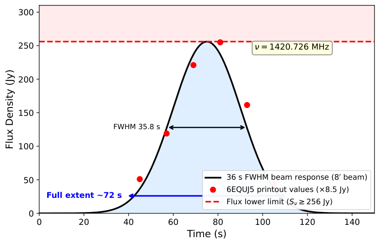
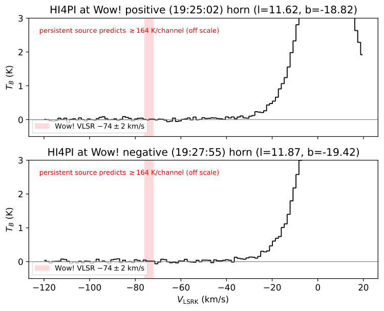
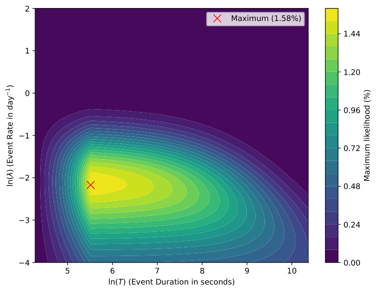

<div align="center">

# Forensic Bounds and Identifiability Limits on the Origin of the Wow! Signal

**Reproducibility package for Shaad & Khan — submitted to the *International Journal of Astrobiology***

[](https://doi.org/10.5281/zenodo.23301789)
[](LICENSE)
[](https://www.python.org/downloads/release/python-3120/)
[](papers/archive/paper-rev2/scripts/verify_all_numbers.py)

*Every headline number and figure below regenerates from frozen public inputs with one command.*

</div>

---

## Results at a glance

| Result | Value | Verified by |
|---|---|---|
| Brightness-temperature bound (compact circular) | $T_B \ge 1.72\times10^4$ K (floor $1.17\times10^4$ K; Gaussian-profile sensitivity $1.19\times10^4$ / $0.81\times10^4$ K) | `reproduce_main_numbers.py` |
| Kipping–Gray chain maxima (published) | $32.3\%$ / $3.3\%$ / $1.78\%$ | released chains, `reproduce_figures_de.py` |
| Emulator: OSU-only → transparent Hobart | $5.62\% \to 2.52\%$ (grid-integrated likelihood ratio $0.65$) | `reproduce_main_numbers.py`, audited by `h5_independent_audit.py` |
| HI4PI persistent-filament check | $\le 0.10$ K/channel measured vs $\gtrsim164$ K predicted (compact); $0.15$ K max over 824 field pixels | `extend_hi4pi.py`, `field_map_hi4pi.py` |
| Comet ephemeris exclusion | on-sky $11.8°$ / $12.5°$ / $10.4°$ / $11.0°$ vs $\pm3$ s / $\pm20'$ boxes | `horizons_recheck.py` (live JPL query) |
| H4 frequency coincidence | $5.05\times10^{-6}$ uniform / $7.64\times10^{-5}$ log-uniform (15.1×) | `freq_prior_compare.py` |

<p align="center">
  
  
  
</p>

## Reproduce everything

```bash
pip install numpy astropy scipy astroquery matplotlib pillow   # Python 3.12
python papers/archive/paper-rev2/scripts/reproduce_main_numbers.py   # headline numbers → main_numbers.json
python papers/archive/paper-rev2/scripts/verify_all_numbers.py      # end-to-end gate, exit 0 iff all pass
```

Full step-by-step (all nine scripts, external inputs, figure mapping):
[`papers/archive/paper-rev2/scripts/number_figure_manifest.md`](papers/archive/paper-rev2/scripts/number_figure_manifest.md)

## Contents

```
paper/                              IJA manuscript (manuscript.tex, CSL class)
                                    + AASTeX mirror + all review figures
papers/archive/paper-rev2/scripts/  analysis + figure + verification scripts
papers/archive/paper-rev2/zenodo/   deposit staging (scripts, JSONs, tables)
data/kipping_master_dl/wow-main/    Kipping–Gray public release mirror (MIT)
research/sources/…/campaign_exposure.csv   Hobart session-span table (shared)
docs/  design notes · background       tools/audit/  reports · ledgers · env
src/ · configs/ · legacy data/         Python package, configs, Phase-2 inputs
```

## Manuscripts

- **IJA (submission):** `papers/archive/paper-rev2/ija_manuscript/manuscript.tex` — pdfLaTeX ×2. `overleaf_upload.zip` is the direct Overleaf bundle.
- **AASTeX mirror:** `papers/archive/paper-rev2/main.tex` (+ `.cls`, `.bst`, `.bib`).

## Data access

- **Public, cited by identifier:** HI4PI (CDS J/A+A/594/A116), Kipping–Gray code+chains (mirrored here, MIT), Méndez et al. arXiv e-prints.
- **Shared here:** Hobart session-span/pointing table only.
- **Restricted (not in this repo):** detection thresholds, candidate-generation rules, candidate lists, raw reduction products — inquiries via the authors, subject to donor consent.

## Citation

```bibtex
@software{shaad2026wow,
  author       = {Shaad, Zubayer Hasan and Khan, S M Shadman},
  title        = {Forensic Bounds and Identifiability Limits on the Origin of the Wow! Signal — reproducibility package},
  version      = {v1.0.0},
  doi          = {10.5281/zenodo.23301789},
  url          = {https://doi.org/10.5281/zenodo.23301789}
}
```

Code: MIT · Data/figures/text: CC-BY-4.0 — see [LICENSE](LICENSE).
